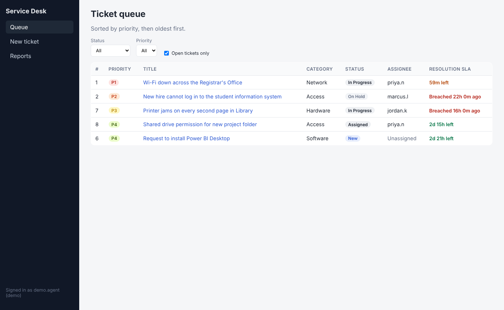
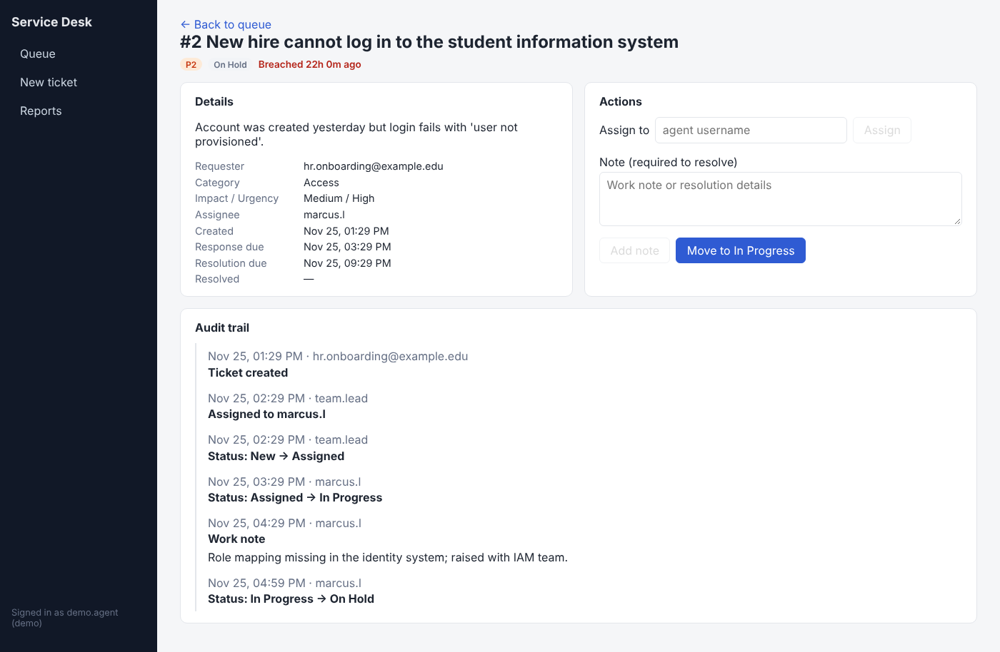
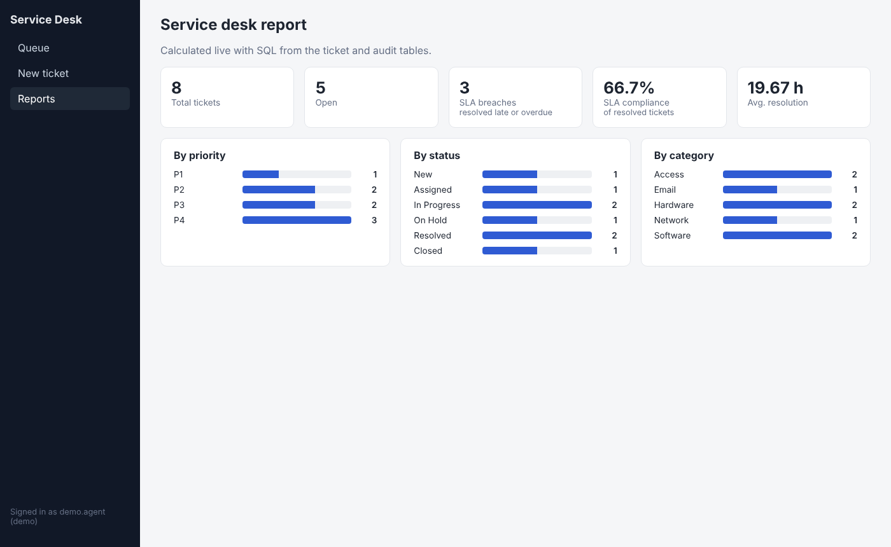

# Service Desk Ticketing System

**Live demo:** https://service-desk-ticketing-system.onrender.com  
<sub>Free hosting: the first visit after a quiet period can take about a minute to wake up. Demo data resets on restart.</sub>

[](https://github.com/bharathgopalswamy/service-desk-ticketing-system/actions/workflows/ci.yml)

An IT service desk backend modelled on how internal support teams handle incidents: tickets get a priority from **impact × urgency**, carry **SLA deadlines**, move through a controlled **status workflow**, and keep a full **audit trail**. A reporting endpoint gives the numbers a support lead reviews each week.

> Status: **v0.2** — REST API, React agent dashboard, demo data, 39 automated tests, Docker. Portfolio project with fictional data.



## Why this project

It demonstrates the day-to-day logic of IT support and application support work — triage, prioritisation, SLA tracking, ticket lifecycle and reporting — implemented as a tested, documented application.

## Screens

| Ticket detail and audit trail | Service desk report |
|---|---|
|  |  |

## Features

- **ITIL-style priority matrix** — impact (High/Medium/Low) × urgency → P1–P4
- **SLA targets** per priority (response and resolution), with breach detection
- **Status workflow** — New → Assigned → In Progress ⇄ On Hold → Resolved → Closed (resolved tickets can be reopened); invalid moves return `409`
- **Resolution notes required** before a ticket can be resolved
- **Audit trail** — every creation, assignment, status change and comment is recorded with actor and time
- **Reporting** — totals, open tickets, SLA breaches, SLA compliance %, average resolution time, and counts by status, priority and category, all in SQL
- **Input validation** with Zod; parameterised SQL queries only
- **Agent dashboard (React)** — queue sorted by priority with a live SLA countdown (on track / at risk / breached), ticket detail with audit trail and only the allowed actions, create form with a live priority preview, and a reports page

## SLA targets

| Priority | First response | Resolution |
|---|---|---|
| P1 | 30 min | 4 h |
| P2 | 2 h | 8 h |
| P3 | 8 h | 24 h |
| P4 | 24 h | 72 h |

## Tech stack

Node.js 22 · Express 5 · SQLite (`node:sqlite`) · Zod · React 19 · Vite · Vitest · React Testing Library · Supertest · ESLint · Docker · GitHub Actions

## Run it

**Docker (one command):**

```bash
docker compose up --build
# open http://localhost:4000 — demo tickets are loaded on first start
```

**Local development** (Node.js 22.5+):

```bash
npm install
npm run seed       # optional: load demo tickets
npm run dev        # API on :4000, dashboard on http://localhost:5173
npm test           # 39 tests (server + client)
npm run lint
```

## API

| Method | Path | Purpose |
|---|---|---|
| GET | `/api/health` | Health check |
| GET | `/api/meta` | Allowed categories, impacts, urgencies, statuses, priorities |
| POST | `/api/tickets` | Create a ticket |
| GET | `/api/tickets?status=&priority=&assignee=` | List (highest priority, then oldest first) |
| GET | `/api/tickets/:id` | Ticket details incl. allowed next statuses |
| GET | `/api/tickets/:id/history` | Audit trail |
| PATCH | `/api/tickets/:id/assignee` | Assign (New → Assigned) |
| PATCH | `/api/tickets/:id/status` | Change status (`note` required for Resolved) |
| POST | `/api/tickets/:id/comments` | Add a work note |
| GET | `/api/reports/summary` | SLA and volume report |

The acting agent is sent in an `X-Agent` header until authentication is added.

Example:

```bash
curl -X POST localhost:4000/api/tickets -H "Content-Type: application/json" -d '{
  "title": "Printer offline",
  "description": "Second floor printer shows offline for everyone.",
  "category": "Hardware",
  "requesterEmail": "user@example.com",
  "impact": "Medium",
  "urgency": "Medium"
}'
```

## Architecture

See [docs/ARCHITECTURE.md](docs/ARCHITECTURE.md) for the component diagram, data model, request flow, design decisions and testing strategy.

```text
client/
├── src/
│   ├── pages/               # Queue, Ticket, New ticket, Reports
│   ├── components/Badges.jsx
│   ├── api.js               # REST client
│   └── sla.js               # SLA countdown state
└── tests/                   # React Testing Library + SLA unit tests
server/
├── src/
│   ├── domain/              # sla.js, workflow.js (pure business rules)
│   ├── db.js                # Schema
│   ├── ticketRepository.js  # Ticket queries + rules + audit events
│   ├── reports.js           # Reporting SQL
│   ├── seed.js              # Fictional demo data
│   ├── app.js               # Routes, validation, errors, static files
│   └── index.js             # Entry point
└── tests/
```

## Roadmap

- [x] v0.1 — API, SLA rules, workflow, audit trail, reporting
- [x] v0.2 — React agent dashboard, demo data, Docker, architecture docs
- [ ] v0.3 — Authentication and roles (requester / agent / lead); SLA clock pauses while On Hold; business-hours SLA
- [ ] v0.4 — Knowledge-base articles linked to resolutions; CSV export and a Power BI report; PostgreSQL option

## Development log

See [DEVLOG.md](DEVLOG.md).

## How this was built

Built with AI pair-programming (Claude Code). I defined the requirements and domain rules (ITIL priority matrix, SLA targets, ticket workflow), reviewed every change through pull requests, and can explain the design decisions documented in [docs/ARCHITECTURE.md](docs/ARCHITECTURE.md). The [DEVLOG](DEVLOG.md) records what changed and why at each step.

## Author

Bharath Gopalsamy — [LinkedIn](https://www.linkedin.com/in/bharathgopalsamy) · [Portfolio](https://bharathgopalsamy.vercel.app)
