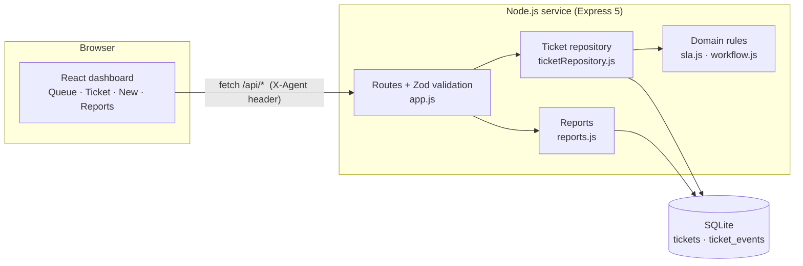
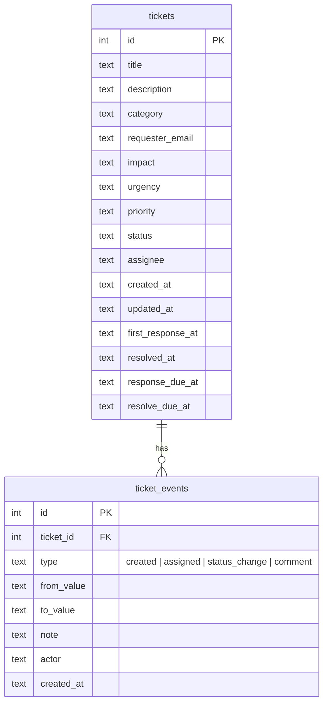

# Architecture

## Overview

A single Node.js service exposes a REST API and serves a React single-page dashboard. Data lives in SQLite. Business rules (priority, SLA, workflow) are plain functions with no framework dependencies, so they are easy to test and to explain.

In development, Vite serves the dashboard on port 5173 and proxies `/api` to the API on port 4000. In production (and in Docker), Express serves the built files from `client/dist`, so there is one process and one port.

## Layers

| Layer | Files | Responsibility |
|---|---|---|
| Domain | `server/src/domain/sla.js`, `workflow.js` | Priority matrix, SLA targets, breach logic, allowed status transitions. Pure functions. |
| Data access | `server/src/ticketRepository.js`, `reports.js`, `db.js` | All SQL. Parameterised queries only. Writes an audit event for every change. |
| HTTP | `server/src/app.js` | Routes, Zod validation, error handling (`TicketError` → status code, everything else → generic 500). |
| UI | `client/src/` | Pages for queue, ticket detail, new ticket and reports. `api.js` wraps fetch; `sla.js` computes countdown state. |

## Data model

Indexes: `tickets(status)`, `tickets(priority)`, `ticket_events(ticket_id)`.

## Request flow: resolving a ticket

1. The dashboard shows only the buttons in `ticket.allowedNextStatuses` (from `workflow.js`).
2. `PATCH /api/tickets/:id/status` with `{ status: "Resolved", note }` and an `X-Agent` header.
3. Zod validates the body. The repository checks the transition is allowed (otherwise `409`) and that a note exists (otherwise `400`).
4. The ticket row is updated (`resolved_at`, `updated_at`) and a `status_change` event is appended with the actor and note.
5. The dashboard reloads the ticket and its audit trail.

## Key decisions

| Decision | Why | Trade-off / next step |
|---|---|---|
| Priority derived from impact × urgency | Consistent triage between agents; mirrors ITIL practice | Matrix is hard-coded; could move to configuration |
| SLA due dates stored at creation | Changing SLA targets later doesn't rewrite history | Clock runs 24/7 and does not pause "On Hold" — business-hours clock and pause are on the roadmap |
| Append-only audit table | Who-did-what-when is required for escalations and SLA reviews | Grows over time; would need archiving at scale |
| SQLite via built-in `node:sqlite` | Zero setup for reviewers; real SQL for reporting | Single-writer; PostgreSQL is the next step for multi-user deployments |
| Injected clock (`now()`) | Tests can simulate hours passing in milliseconds | Slightly more plumbing in the repository |
| No chart library | The report only needs bar charts of counts; keeps the bundle small | Richer analytics would justify a library or Power BI export |
| `X-Agent` header instead of auth | Keeps v0.2 focused on the workflow | Authentication and roles are the v0.3 milestone |

## Testing strategy

- **Domain tests** — every priority combination, SLA due-date maths, breach edge cases, allowed/blocked transitions.
- **API tests (Supertest)** — full ticket lifecycle against an in-memory database with a controllable clock, validation errors, 404/409 paths, report numbers.
- **Seed test** — demo data follows the same workflow rules as real use.
- **Component tests (React Testing Library)** — queue rendering and filtering, only-allowed actions on the ticket page, resolution note requirement, live priority preview on the create form. `fetch` is mocked.
- **CI** — lint, tests and build on every push/PR, then a Docker build and container smoke test.
